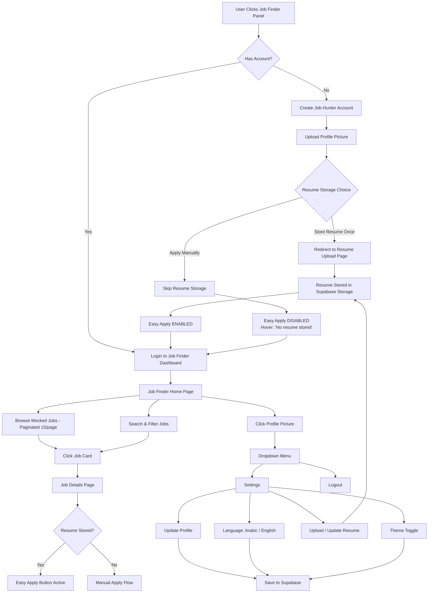
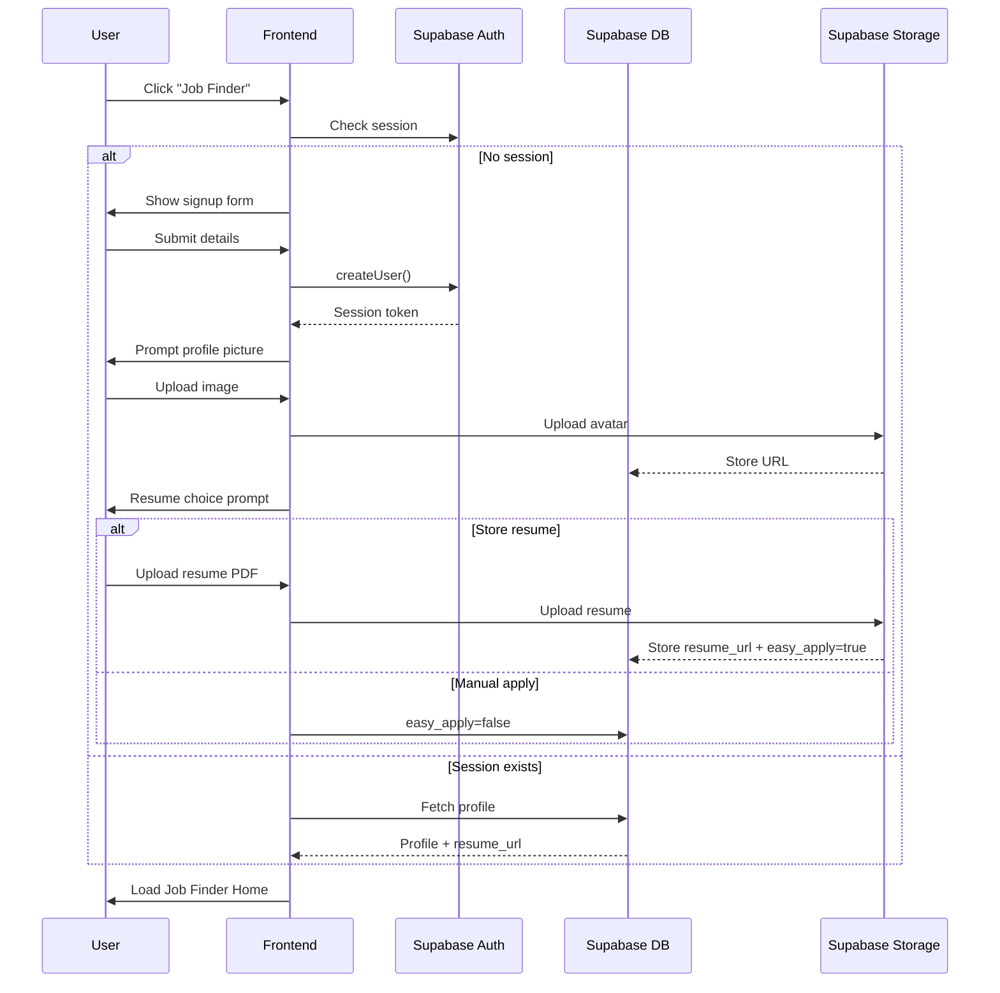
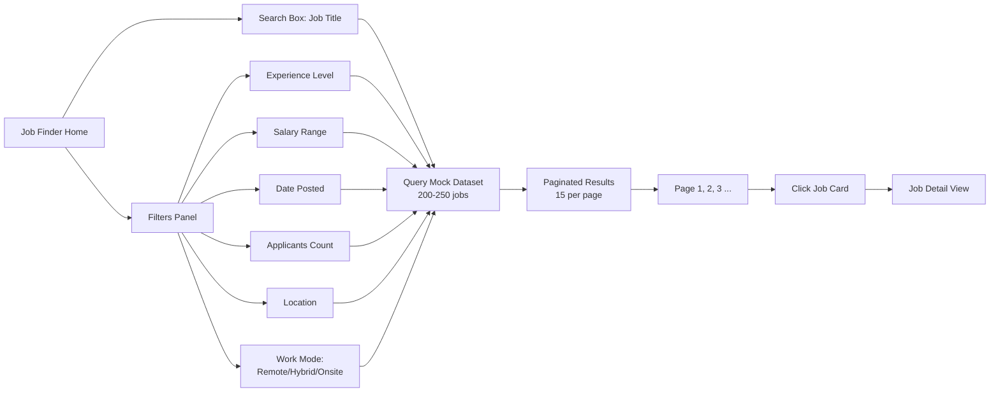
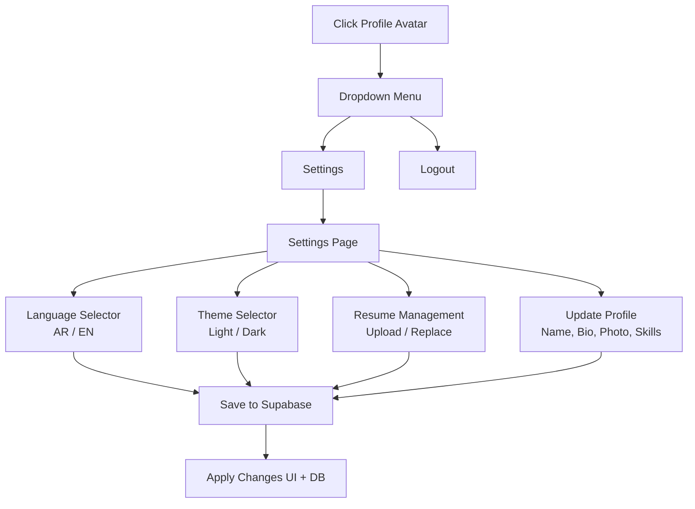
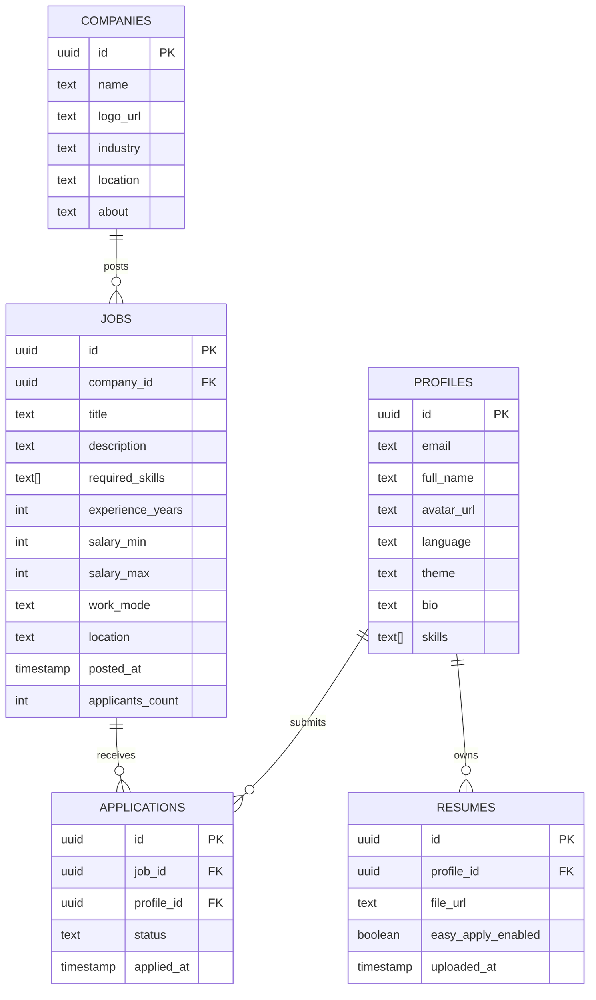

# ittisal

ittisal / اتصال is a bilingual Gulf work platform for connecting job seekers, employers, and investors across the GCC. The current repository contains the initial marketing site and the documented foundation for the **Job Finder Panel**.

## Current stack

- Next.js App Router with React and JSX
- Tailwind CSS
- Framer Motion
- Supabase planned for authentication, database persistence, and file storage
- English and Arabic interface support
- Light, dark, aurora, and nocturne themes

## Run locally

```bash
npm install
npm run dev
```

Open `http://localhost:3000`.

Useful checks:

```bash
npm run build
```

## Current routes

| Route | Purpose |
| --- | --- |
| `/` | Landing page |
| `/hunter` | Job hunter login entry |
| `/hunter/onboarding` | Job hunter account and resume onboarding |
| `/hunter/jobs/[id]` | Job detail and apply flow |
| `/hunter/settings` | Job hunter profile settings |
| `/employers` | Employer login entry |
| `/investors` | Investor login entry |
| `/careers` | Careers at ittisal |
| `/settings` | Language and theme preferences |

## Job Finder Panel scope

The Job Finder Panel will provide:

1. Account creation and login through Supabase Auth.
2. Profile picture upload and profile management.
3. Optional one-time resume storage through Supabase Storage.
4. Easy Apply when a stored resume exists.
5. Manual application flow when no resume is stored.
6. A mocked dataset of 150 distinct jobs.
7. Search by job title.
8. Filters for experience, salary, date posted, applicant count, location, and work mode.
9. Pagination at 15 jobs per page.
10. Job detail pages and application status tracking.
11. Arabic/English language selection and light/dark theme selection.

The detailed flows are maintained in the Mermaid files in the repository root:

- `job-finder-panel-flow.mmd`
- `account-creation-resume-flow.mmd`
- `job-search-filter-logic.mmd`
- `settings-profile-menu-flow.mmd`
- `supabase-data-model.mmd`

## Planned Supabase entities

The Job Finder Panel data model includes:

- `PROFILES`
- `RESUMES`
- `COMPANIES`
- `JOBS`
- `APPLICATIONS`

The complete entity relationship diagram is in `supabase-data-model.mmd`. Employer and investor panel requirements will be documented separately when defined.

## Job Finder implementation status

The current frontend prototype includes the complete client flow with local browser persistence:

- Account onboarding and sign-in state
- Profile setup with age, profile picture, degree, field of study, location, bio, and skills
- Polished profile picture and resume file pickers
- Optional resume upload selection
- Mock GCC job dataset
- Search by title, skill, or company
- Work mode, experience, and location filters
- Paginated results
- Job detail pages
- Easy Apply when a resume is stored
- Manual apply fallback when no resume is stored
- Profile menu, logout, language, and theme controls

Supabase Auth, Database, and Storage are the next integration boundary; no credentials are committed to this repository.

## Job Finder Panel diagrams

### 1. Job Finder Panel flow



### 2. Account creation and resume flow



### 3. Job search and filter logic



### 4. Settings and profile menu



### 5. Supabase data model



## Asset placeholders

Replace the testimonial/profile placeholders in `public/images/` with the final images when available.
